

# 🧩 آرمانو: آموزش مفاهیم فضایی به کودکان دارای اوتیسم

**اپلیکیشن آموزشی موبایل، آفلاین و به زبان فارسی، ساخته‌شده با Flutter**

یادگیری چندحسی، بدون فشار زمانی، تکرار تا تسلط

---

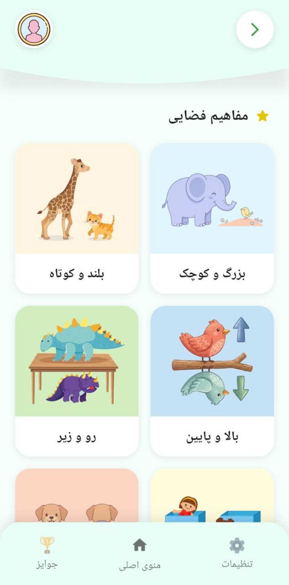
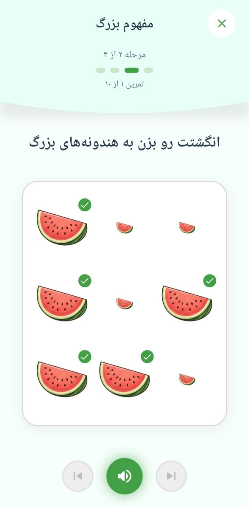
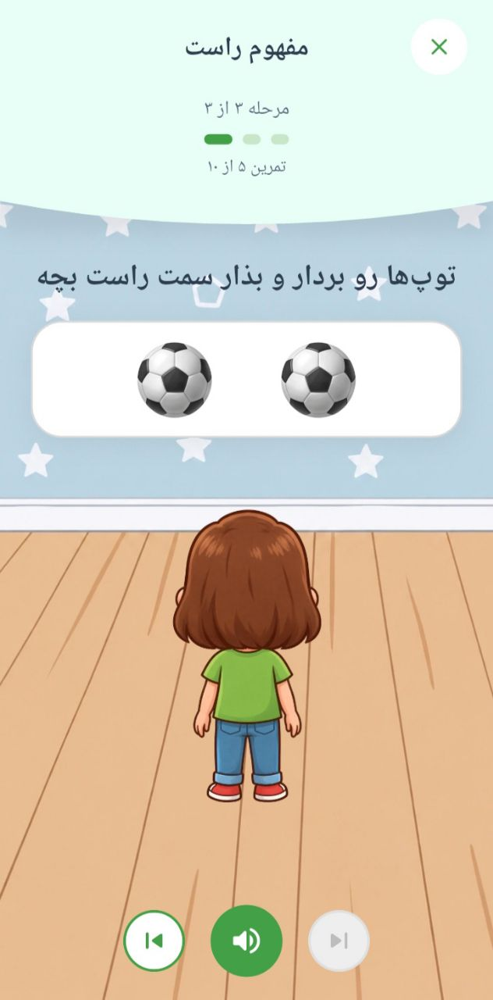
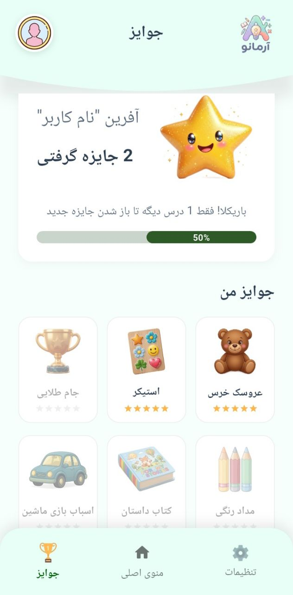

---

**فهرست مطالب**

۱. [درباره‌ی پروژه](#about) 
۲. [نمایش عملکرد اپ](#demo) 
۳. [وضعیت پروژه](#status) 
۴. [اصول طراحی آموزشی](#principles) 
۵. [مفاهیم و مراحل آموزشی](#concepts) 
۶. [امکانات](#features) 
۷. [معماری و تکنولوژی‌ها](#architecture) 
۸. [موتور تمرین‌های موقعیتی](#positional-engine) 
۹. [فعالیت تلفیق](#integration) 
۱۰. [سیستم صوتی](#audio) 
۱۱. [ذخیره‌سازی و پیشرفت](#persistence) 
۱۲. [کنترل کیفیت](#quality) 
۱۳. [اهداف آینده‌ی توسعه](#roadmap) 
۱۴. [تیم و روند توسعه](#team)

---

## 🎯 درباره‌ی پروژه

آرمانو را یک تیم چهارنفره به سفارش سرکار خانم جهانگیری (کارفرما) و با سرپرستی و همراهی مستمر دکتر سخندان ساخته است. هدف پروژه آموزش مفاهیم پایه‌ی ریاضی و فضایی، مانند بزرگ و کوچک، بالا و پایین، داخل و خارج، راست و چپ، و... به کودکانی با نیازهای خاص در یادگیری است. مفاهیم گام‌به‌گام، با تکرار زیاد و بازخورد فوری صوتی و تصویری آموزش داده می‌شوند.

هر تمرین ترکیبی از 🖼️ تصویر · 🔊 صدای دستورالعمل · 👆 لمس و انتخاب · ✋ کشیدن و رها کردن · 📳 بازخورد لمسی · 🎉 انیمیشن تشویق یا خطا · 💾 ذخیره‌ی خودکار پیشرفت است.

اپ سرور و پایگاه‌داده‌ی آنلاین ندارد: همه‌ی داده‌ها روی دستگاه ذخیره می‌شوند و اپلیکیشن بدون نیاز به اینترنت کار می‌کند، که برای استفاده‌ی کودکان در هر محیطی مناسب است. نسخه‌ی تحویل‌شده‌ی پروژه برای سیستم عامل اندروید است.

**نکته:** این ریپازیتوری صرفاً برای معرفی پروژه است و شامل توضیحات، تصاویر و ویدیوهای نمایشی می‌شود؛ کد منبع پروژه در آن قرار ندارد.

---

## 🎬 نمایش عملکرد اپ

چهار ویدیوی کوتاه، چهار بخش اصلی اپ را نشان می‌دهند.

### ۱. ورود و منوی مفاهیم فضایی

ثبت‌نام و ورود، صفحه‌ی اصلی و منوی ۹ گروه مفهومی.

<!-- VIDEO_1: ویدیو را در ویرایشگر GitHub بکش و رها کن و آدرس user-attachments را اینجا، در یک خط جدا، بگذار -->

### ۲. آموزش یک مفهوم، گام‌به‌گام

مراحل آموزش یک مفهوم، از دیدن و شنیدن تا لمس و کشیدن و رها کردن.

<!-- VIDEO_2: آدرس ویدیو را اینجا، در یک خط جدا، بگذار -->

### ۳. فعالیت تلفیق

تمرین هم‌زمان دو مفهوم متضاد در یک فعالیت.

<!-- VIDEO_3: آدرس ویدیو را اینجا، در یک خط جدا، بگذار -->

### ۴. جوایز، پیشرفت و تنظیمات

جوایز، شمارنده‌ی پیشرفت و تنظیمات صوتی.

<!-- VIDEO_4: آدرس ویدیو را اینجا، در یک خط جدا، بگذار -->

---

## ✅ وضعیت پروژه

بخش «مفاهیم فضایی» کاملاً پیاده‌سازی شده و هر ۹ دسته‌بندی مفهومی، شامل آموزش هر دو مفهوم و فعالیت تلفیق آن‌ها، قابل اجرا هستند.

| بخش | وضعیت |
|---|---|
| ثبت‌نام، ورود، بازیابی رمز، چندحسابی روی یک دستگاه | ✅ کامل |
| صفحه‌ی اصلی، پروفایل، تنظیمات، حریم خصوصی، پشتیبانی، جوایز | ✅ کامل |
| مفاهیم اندازه‌ای: بزرگ/کوچک، بلند/کوتاه | ✅ کامل (۴ مرحله + تلفیق) |
| مفاهیم موقعیتی: بالا/پایین، رو/زیر، داخل/خارج، جلو/عقب، راست/چپ، اول/آخر، دور/نزدیک | ✅ کامل (۳ مرحله + تلفیق) |
| بخش «آزمون» هر گروه | 🔜 طبق تصمیم کارفرما در نسخه‌ی بعد |
| منوی «آموزش ریاضی» (۸ گزینه) | 🔜 فعلاً فقط «مفاهیم فضایی» محتوا دارد |

---

## 🧠 اصول طراحی آموزشی

| اصل | پیاده‌سازی |
|---|---|
| **بدون محدودیت زمانی** | هیچ‌جای اپ به مدت‌زمان پاسخ‌دهی کودک حساس نیست و بر اساس آن چیزی قضاوت یا ثبت نمی‌شود |
| **تکرار تا تسلط** | هر مرحله چندین تکرار دارد و با انجام همه‌ی آن‌ها تکمیل می‌شود. پاسخ اشتباه جریمه ندارد: صدای تذکر و افکت لرزش پخش می‌شود (در کشیدن و رها کردن، شیء به جای اول برمی‌گردد) و کودک همان تمرین را دوباره امتحان می‌کند |
| **دشواری بدون برچسب** | هیچ برچسب «آسان/سخت»ی نمایش داده نمی‌شود. سطح دشواری تمرین‌ها متنوع است (مثلاً در مفاهیم اندازه‌ای، تفاوت اندازه‌ی دو شیء در تمرین‌های مختلف فرق می‌کند) و چون ترتیب تمرین‌ها تصادفی است، این سطوح به‌صورت آمیخته ارائه می‌شوند |
| **صدای اختصاصی برای هر تمرین** | هر تکرار، جمله‌ی گفتاری خودش را دارد (مثلاً «این توپ‌ها بزرگ‌اند»)، چون ممکن است کودک نام اشیا را نداند |
| **تصادفی‌سازی در هر ورود** | ترتیب تمرین‌ها و چیدمان، موقعیت و تعداد اشیا هر بار از نو ساخته می‌شود تا پاسخ‌ها حفظ نشوند. در «اول و آخر» جهت صف هم تصادفی قرینه می‌شود تا کودک مفهوم را از جهت حرکت صف یاد بگیرد، نه با حفظ کردن سمت چپ یا راست |
| **خوانایی بیشتر** | اندازه‌ی متن ۱.۱۵ برابر شده و تمام صفحه‌ها راست‌به‌چپ (RTL) طراحی شده‌اند |
| **پایداری** | مشکل ذخیره‌سازی هرگز تمرین کودک را قطع نمی‌کند ([ذخیره‌سازی و پیشرفت](#persistence)) |

---

## 📚 مفاهیم و مراحل آموزشی

مفاهیم در **۹ دسته‌بندی (جفت‌مفهوم)** سازمان‌دهی شده‌اند و هر دسته‌بندی چهار بخش دارد: آموزش مفهوم اول، آموزش مفهوم دوم، تلفیق و آزمون. 
مرحله‌ی «بچین» فقط برای مفاهیم اندازه‌ای معنا دارد؛ برای مفاهیم موقعیتی، سه مرحله‌ی اول آموزش را کامل می‌کنند.

| خانواده | مفاهیم | صحنه‌ها و اشیای آموزشی |
|---|---|---|
| اندازه‌ای | بزرگ / کوچک | — |
| اندازه‌ای | بلند / کوتاه | — |
| موقعیتی | بالا / پایین | قفسه، درخت، ابر، پله، چهارپایه، سرسره |
| موقعیتی | رو / زیر | مبل، میز، صندلی، تخت |
| موقعیتی | داخل / خارج | سبد، سطل، کمد، جعبه |
| موقعیتی | جلو / عقب | سرسره، کالسکه، ماشین |
| موقعیتی | راست / چپ | پسر، دختر، خانم، ماشین، کالسکه |
| موقعیتی | اول / آخر | مدرسه، خیابان، حیاط، مزرعه |
| موقعیتی | دور / نزدیک | درخت، ماشین، خانه، گل |

 

| مرحله | نام | توضیح | اندازه‌ای | موقعیتی |
|---|---|---|:-:|:-:|
| ۱ | گوش کن و ببین | نمایش مفهوم همراه با صدای توضیح | ✅ | ✅ |
| ۲ | نشونش بده | لمس شیء یا اشیای درست | ✅ | ✅ |
| ۳ | انتخابش کن | کشیدن شیء و رها کردن آن در ناحیه‌ی درست | ✅ | ✅ |
| ۴ | بچین | چیدن اشیا به‌ترتیب اندازه | ✅ | ❌ |

 

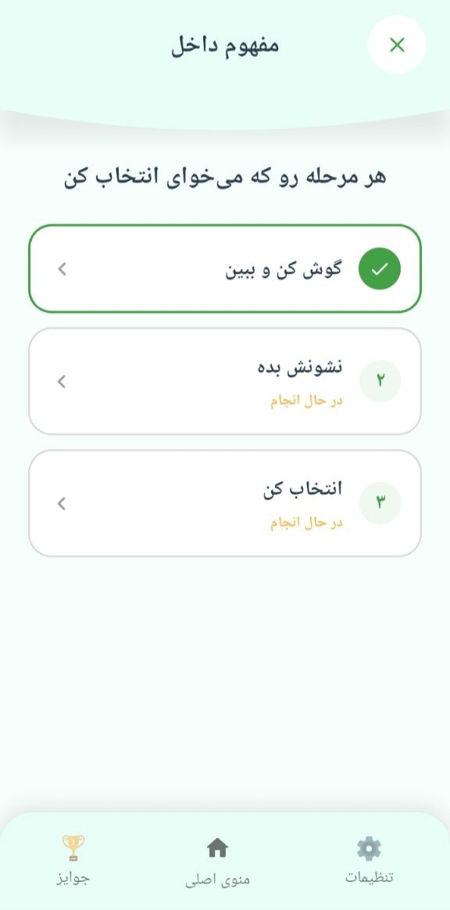
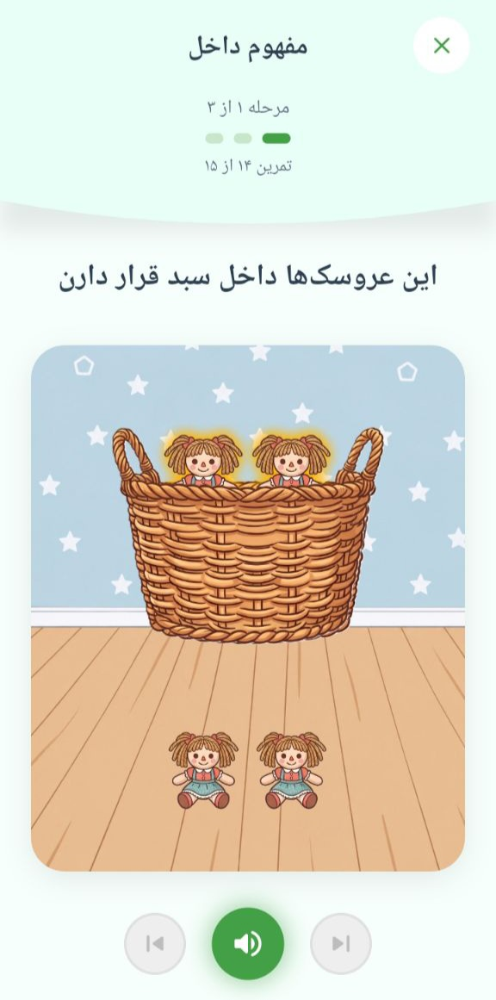
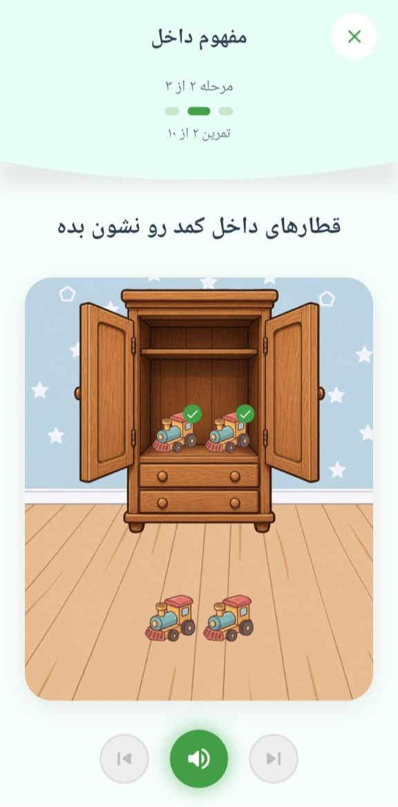
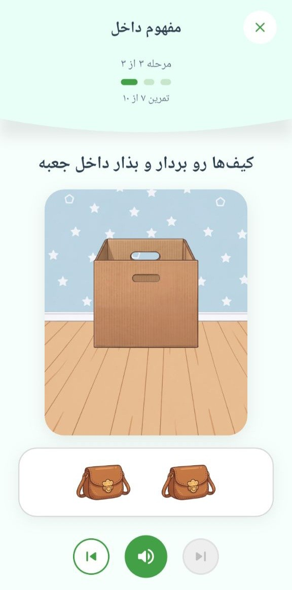

---

## ✨ امکانات

| حوزه | امکانات |
|---|---|
| **حساب کاربری** | ثبت‌نام و ورود محلی، بازیابی رمز با سؤال امنیتی، چند حساب کاربری مستقل روی یک دستگاه (پیشرفت، جلسه‌ها و جوایز هر حساب جداست)، تغییر نام‌کاربری بدون از دست رفتن سابقه، تغییر رمز و عکس پروفایل |
| **تمرین** | ادامه‌ی تمرین از همان‌جا که کودک رها کرده بود، بازخورد چندحسی (صدا، لرزش، انیمیشن خطا و جشن)، دستورالعمل‌های فارسی که متن‌شان خودکار ساخته می‌شود، فعالیت تلفیق با پرسش «ادامه بدهیم یا از اول؟» |
| **جوایز و پیشرفت** | ۶ جایزه (عروسک خرس، استیکر، جام طلایی، مداد رنگی، کتاب داستان، اسباب‌بازی ماشین) که با پیشرفت کودک باز می‌شوند، شمارنده‌ی «چند بار تکمیل شده» و نشان روی کارت هر مفهوم |
| **تنظیمات** | روشن/خاموش کردن صدا و موسیقی، کنترل ولوم، و «پخش خودکار صداها»: اگر فعال باشد، توضیح هر تمرین با اندکی تأخیر خودکار پخش می‌شود و اگر غیرفعال باشد، صدا فقط با فشردن دکمه‌ی بلندگو پخش می‌شود. همچنین حریم خصوصی و پشتیبانی با تماس و پیامک مستقیم. تنظیمات ظاهری و زبان فعلاً ثابت‌اند: اپ یک تم روشن و یک زبان (فارسی) دارد، طبق تصمیم کارفرما |

 

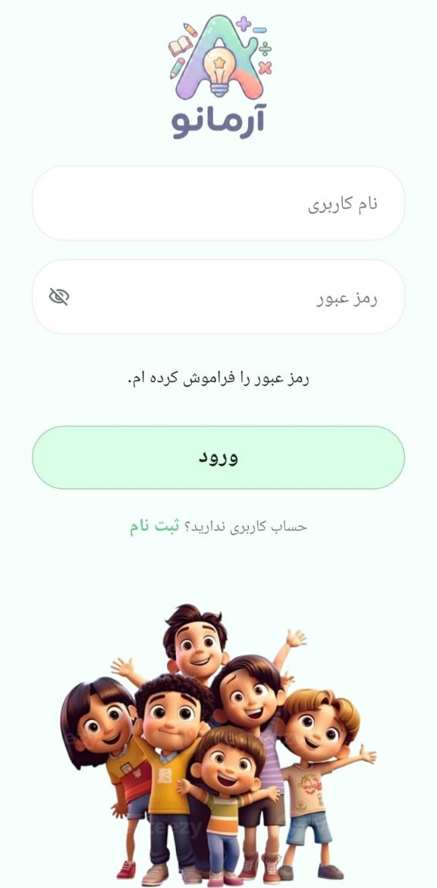
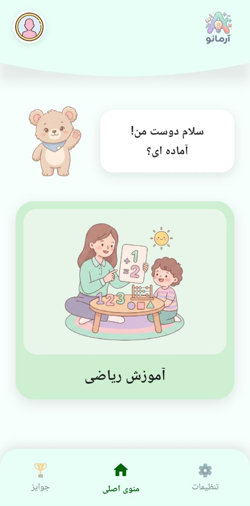
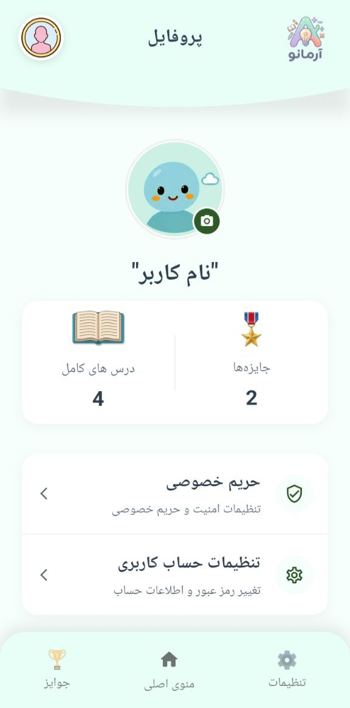
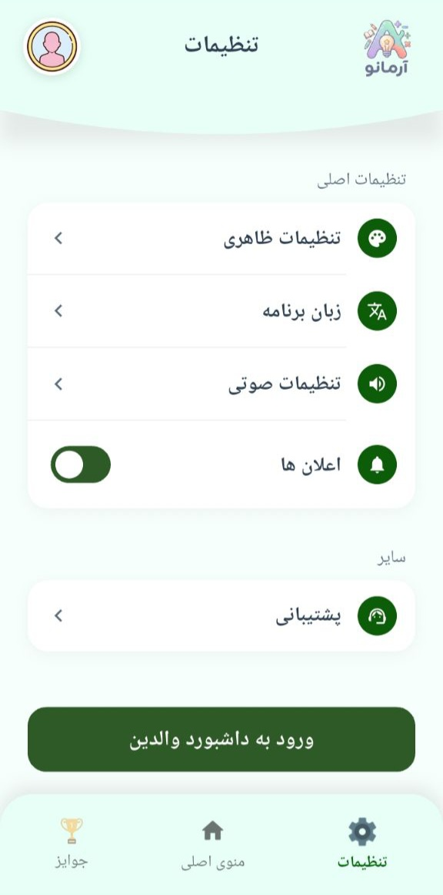

---

## 🏗 معماری و تکنولوژی‌ها

اپ بر پایه‌ی **طراحی داده‌محور (Data-Driven)** ساخته شده است: «مفهوم آموزشی» کاملاً از «موتور اجرای تمرین» جداست. هر مفهوم فقط یک مجموعه داده است (اشیا، صحنه‌ها، صداها و متن‌ها) و یک موتور ثابت و مشترک آن را اجرا می‌کند. نتیجه این است که افزودن مفهوم جدید به ساخت صفحه‌ی تازه نیاز ندارد و فقط محتوای آن تعریف می‌شود.

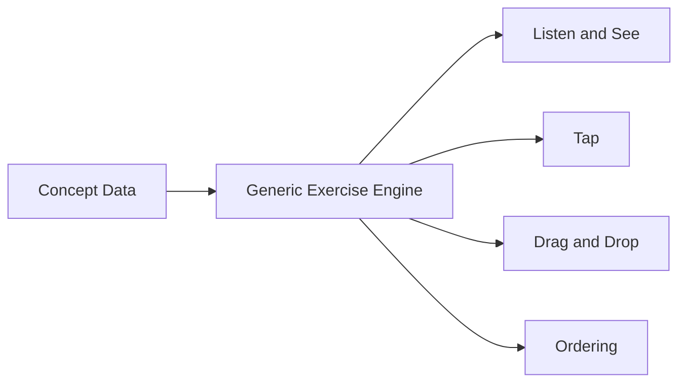

پروژه سه مفهوم کلیدی دارد: ۱) **دو خانواده‌ی مفاهیم**، اندازه‌ای و موقعیتی، که عمداً سیستم‌های جدا دارند چون منطق تشخیص «درست و غلط» برای «اندازه» و «موقعیت» ذاتاً متفاوت است؛ ۲) **تلفیق** که برای هر دسته‌بندی یک فعالیت مستقل است؛ ۳) **پیشرفت هر کاربر** که به‌صورت جداگانه ذخیره می‌شود.

| بخش | تکنولوژی | کاربرد |
|---|---|---|
| فریم‌ورک | Flutter / Dart | توسعه‌ی اپ با یک کدبیس و رابط کاملاً راست‌به‌چپ |
| مدیریت وضعیت | Riverpod | مدیریت وضعیت تمرین‌ها، صدا، تنظیمات و پیشرفت |
| مسیریابی | go_router | ناوبری بین صفحه‌ها و هدایت خودکار بر اساس وضعیت ورود کاربر |
| ذخیره‌سازی محلی | Hive | پیشرفت مراحل و تاریخچه‌ی جلسه‌ها |
| ذخیره‌سازی امن | flutter_secure_storage | رمز عبور و سؤال امنیتی (رمزنگاری‌شده) |
| تنظیمات | shared_preferences | تنظیمات ساده‌ی کاربر |
| صدا | just_audio, audio_session | پخش چندلایه‌ی صدا و مدیریت وقفه‌های سیستم‌عامل |
| ولوم | volume_controller | اتصال اسلایدر اپ به ولوم واقعی دستگاه |
| تصویر پروفایل | image_picker | انتخاب عکس پروفایل |
| ارتباط | url_launcher | تماس و پیامک از صفحه‌ی پشتیبانی |
| بومی‌سازی | flutter_localizations | زبان فارسی و جهت راست‌به‌چپ |

---

## 🧭 موتور تمرین‌های موقعیتی

مفاهیم موقعیتی (بالا و پایین، داخل و خارج، و...) روی صحنه‌های تصویری اجرا می‌شوند که ناحیه‌های درست و غلط هرکدام جداگانه تعریف شده‌اند. موتور این قابلیت‌ها را پشتیبانی می‌کند:

| قابلیت | توضیح |
|---|---|
| **سازگاری با اندازه‌ی صفحه** | ناحیه‌ها نسبت به اندازه‌ی کارت تعریف می‌شوند و روی هر اندازه‌ی گوشی یا تبلت درست رندر می‌شوند |
| **لایه‌بندی عمق** | در «داخل/خارج» ظرف از دو لایه‌ی تصویر ساخته می‌شود تا شیء واقعاً «داخل» ظرف دیده شود |
| **ناحیه‌های ممنوعه** | در «دور/نزدیک» و «خارج» کودک نمی‌تواند شیء را روی خود شیء مرجع رها کند و ناحیه‌ی درست می‌تواند چند سمت داشته باشد |
| **سطوح شیب‌دار** | ناحیه‌های چرخان برای پله و سرسره |
| **سایه‌ی خودکار** | در «رو/زیر» شیءِ قرارگرفته در «زیر» کمی تیره‌تر نمایش داده می‌شود |
| **حالت صف** | در «اول/آخر» چند شیء در یک صف چیده می‌شود و جهت صف تصادفی قرینه می‌شود |
| **چسبیدن هوشمند** | در راست/چپ، داخل و اول/آخر شیء به جای خودش می‌چسبد؛ در دور/نزدیک همان‌جا که رها شد می‌ماند |

**جمله‌ساز فارسی:** متن دستورالعمل هر تمرین دستی نوشته نمی‌شود و از روی داده ساخته می‌شود. قواعد زبان فارسی مثل نشانه‌ی جمع، «ی» میانجی و استثنای اسم‌های ختم‌شده به «ه» و «ی» خودکار رعایت می‌شوند (مثلاً «گلوله‌های کاموا» به‌جای «گلوله کامواها») و متن با صدای ضبط‌شده‌ی هر سناریو هم‌خوان می‌ماند.

---

## 🔗 فعالیت تلفیق

هر دسته‌بندی یک فعالیت تلفیق دارد که کودک در آن هر دو مفهوم را کنار هم تمرین می‌کند، مثلاً هم «بالا» و هم «پایین» در یک تمرین. تلفیق اندازه‌ای و موقعیتی عمداً دو سیستم جدا دارند: تمرین‌های اندازه‌ای روی قفسه، میز و سبد و تمرین‌های موقعیتی روی صحنه‌های مرجع اجرا می‌شوند.

• ترتیب پرسش‌ها هر بار تصادفی می‌شود تا کودک ترتیب پاسخ‌ها را حفظ نکند. 
• تعداد اشیای هر تمرین می‌تواند دقیقاً مشخص باشد (مثلاً دو پروانه و یک بادکنک). 
• تشخیص جای شیء بر اساس نسبت ابعاد واقعی تصویر آن انجام می‌شود و تصاویر تمرین بعدی از قبل آماده می‌شوند تا بین تمرین‌ها پرشی دیده نشود. 
• پیشرفت و ادامه‌ی هر فعالیت تلفیق مستقل از آموزش تکی ذخیره می‌شود و شمارنده‌ی جوایز هر دسته‌بندی با بقیه قاطی نمی‌شود. 

---

## 🔊 سیستم صوتی

صدا نقش اصلی در آموزش دارد و برای کودکان با دقت بیشتری طراحی شده است:

• **سه کانال مستقل:** روایت و دستورالعمل، افکت کوتاه موفقیت و خطا، و صدای پس‌زمینه. یک افکت کوتاه هیچ‌وقت صدای دستورالعمل را ناخواسته قطع نمی‌کند. 
• **رفتار درست با وقفه‌ها:** با اعلان‌های کوتاه، صدای اپ موقتاً کم می‌شود و با تماس تلفنی، پخش متوقف می‌شود و بعد از تماس ادامه پیدا می‌کند. 
• **بدون تداخل صدا:** اگر کودک پیش از تمام شدن یک صدا به تمرین بعدی برود، صدای قدیمی اشتباهاً روی تمرین جدید پخش نمی‌شود. 
• **صف پخش:** در تمرین‌هایی مثل «اول/آخر»، صدای تشویق کامل پخش می‌شود و بعد با مکثی کوتاه دستورالعمل بعدی گفته می‌شود تا دو صدا با هم قاطی نشوند. 
• **پخش خودکار قابل تنظیم:** پخش خودکار صدا را می‌توان خاموش کرد تا صدا فقط با دکمه‌ی بلندگو پخش شود.

---

## 💾 ذخیره‌سازی و پیشرفت

تمام داده‌ها روی خود دستگاه می‌مانند: پیشرفت و تاریخچه‌ی جلسه‌ها در Hive، رمز و سؤال امنیتی به‌صورت رمزنگاری‌شده در Secure Storage و تنظیمات ساده در SharedPreferences. چند تصمیم مهم:

• **هر کاربر یک شناسه‌ی یکتا و پایدار دارد** و پیشرفت و جوایزش با همین شناسه ذخیره می‌شود، نه با نام‌کاربری. تغییر نام‌کاربری سابقه‌ی آموزشی را از بین نمی‌برد و پیشرفت دو حساب هرگز قاطی نمی‌شود. 
• **به‌روزرسانی بدون از دست رفتن پیشرفت:** داده‌ی نسخه‌های قدیمی هنگام به‌روزرسانی اپ به‌صورت خودکار و شفاف به ساختار جدید منتقل می‌شود. 
• **تحمل‌پذیری در برابر خطا:** ذخیره‌ی پیشرفت اغلب میان یک تعامل زنده با کودک انجام می‌شود (مثلاً درست بعد از یک پاسخ صحیح). به همین دلیل خطای ذخیره‌سازی بی‌صدا مدیریت می‌شود: در بدترین حالت فقط همان یک لحظه ذخیره نمی‌شود، ولی اپ هرگز بسته نمی‌شود و جریان تمرین قطع نمی‌شود.

---

## 🧪 کنترل کیفیت

هر نسخه پیش از تحویل مراحل مشخصی را طی کرده است: تست کامل روی دستگاه واقعی (ناوبری، هر مرحله‌ی آموزشی، صدا، ادامه‌ی تمرین، تکمیل و تلفیق، و جدا بودن پیشرفت کاربران)، فهرست‌کردن و تقسیم ایرادات برای رفع، و در نهایت بررسی مرحله‌به‌مرحله‌ی دکتر سخندان پیش از ارسال APK به کارفرما. با هر مفهوم جدید، مفاهیم قبلی هم دوباره تست می‌شدند. همچنین در حالت توسعه، ساختار محتوای هر تمرین (مثلاً کامل بودن صدا، تصویر و ناحیه‌ها) خودکار اعتبارسنجی شده تا هرگونه مشکلی پیش از رسیدن به کاربر پیدا شود.

---

## 🚀 اهداف آینده‌ی توسعه

معماری پروژه طوری ساخته شده که ادامه‌ی توسعه بیشتر به تولید محتوا نیاز دارد تا نوشتن کد جدید. از توسعه های احتمالی آینده میتوان به موارد زیر اشاره کرد: 
• **بخش آزمون** برای هر دسته‌بندی مفهومی. 
• **داشبورد پیشرفت برای والدین و مربیان:** تاریخچه‌ی جلسه‌ها از قبل ذخیره می‌شود و هدف نمایش آن در قالب گزارش است. 
• **تکمیل منوی «آموزش ریاضی»:** مفاهیم پیش‌نیاز، درک اعداد، چهار عمل اصلی، درک اندازه‌ها، محاسبات، اشکال هندسی و کسرها، با همان معماری داده‌محور.

---

## 👥 تیم و روند توسعه

پروژه در دو فاز توسعه یافت و ترکیب تیم و تقسیم کار این دو فاز تفاوت داشت: فاز اول بیشتر صرف طراحی معماری، زیرساخت و منطق برنامه شد و فاز دوم، با تکیه بر همان معماری، بیشتر کار فرانت‌اند و افزودن سایر محتوای مفاهیم موقعیتی بود.

### 🎓 همراهان پروژه

**دکتر سخندان (سرپرست تیم)** فراتر از سرپرستی در تمام مسیر کنار تیم بودند: 
• پیش از ارسال هر APK به کارفرما، اپ را مرحله‌به‌مرحله بررسی می‌کردند و ایرادهایی را که تیم ندیده بود گوشزد می‌کردند. 
• در ایده‌پردازی و پیدا کردن راه‌حل به تیم کمک می‌کردند. 
• ابهام‌های فرایند آموزشی را از طریق ایشان با کارفرما در میان می‌گذاشتیم تا پاسخ را سریع‌تر دریافت کنیم و روند توسعه متوقف نشود.

**سرکار خانم جهانگیری (کارفرما)** مشاور و ناظر بخش منطق تجاری نرم‌افزار بودند و فایل‌های صوتی پروژه را بر اساس متن‌های تهیه‌شده‌ی تیم آماده می‌کردند.

### فاز اول: طراحی معماری، زیرساخت مفاهیم اندازه‌ای و موقعیتی

**اعضا:** زهرا ملکی، عرفان نوبهار، بهاره ندرلو، ثنا فکروند

| حوزه | سهم از کل کار | اعضا و سهم هرکدام از حوزه |
|---|:-:|---|
| منطق، توسعه‌ی هسته، معماری و ساختار | ۶۰٪ | زهرا ملکی ۶۵٪ · عرفان نوبهار ۳۵٪ |
| فرانت‌اند، رابط کاربری، طراحی در Figma و زیباسازی | ۴۰٪ | بهاره ندرلو ۶۵٪ · ثنا فکروند ۳۵٪ |

سهم تقریبی هر عضو از کل کار فاز اول: زهرا ملکی ۳۹٪ ، بهاره ندرلو ۲۶٪ ، عرفان نوبهار ۲۱٪ ، ثنا فکروند ۱۴٪

| عضو | فعالیت‌ها |
|---|---|
| **زهرا ملکی** | مدیریت پروژه و تقسیم تسک‌ها میان اعضا؛ طراحی معماری و ساختار پروژه (از جمله مکانیزم جنریک داده‌محور)؛ اعمال بهبودهای ساختاری در طول توسعه؛ تهیه‌ی مستندات از ابتدای پروژه (رودمپ، فازبندی و تقسیم کارها) و توضیح تغییرات ساختاری به هم‌تیمی‌ها؛ تهیه‌ی گزارش فنی فاز اول و گزارش راهنمای ادامه‌ی توسعه برای تیم (رودمپ، نکات ساختاری و ریفکتورها)؛ بازبینی فایل‌های صوتی و تهیه‌ی مستندات مربوط به صوت‌ها؛ تست و دیباگ مکرر به‌طوری که پیش از ارسال APK ایرادات به حداقل برسد؛ همراهی در بخش‌هایی از فرانت‌اند |
| **عرفان نوبهار** | مشارکت در توسعه‌ی منطق، هسته‌ی برنامه و ساختار پروژه، همکاری در رفع برخی باگ‌ها |
| **بهاره ندرلو** | توسعه‌ی فرانت‌اند و UI؛ مشارکت در تهیه‌ی مستندات فایل‌های صوتی؛ همراهی در بررسی فایل‌های صوتی و تغییر فرمت آن‌ها؛ مشارکت در تست و رفع باگ‌ها |
| **ثنا فکروند** | توسعه‌ی فرانت‌اند و UI؛ مشارکت در تهیه‌ی مستندات فایل‌های صوتی؛ همکاری در تست بخش‌ها |

### فاز دوم: ادامه مفاهیم موقعیتی، تلفیق و تکمیل پروژه

**اعضا:** بهاره ندرلو، ثنا فکروند، عرفان نوبهار

با توجه به شباهت معماری مفاهیم موقعیتی به الگوی «بالا/پایین»، سهم منطق و داده کمتر شد و تقسیم کار این فاز تقریباً **۷۰٪ فرانت‌اند و ۳۰٪ منطق و داده** بود.
فاز دوم بر پایه‌ی معماری و مستندات فاز اول انجام شد؛ همین معماری باعث شد افزودن ۶ دسته‌بندی موقعیتی باقی‌مانده بدون تغییر در موتور اصلی انجام شود.

| عضو | مدیریت پروژه | فرانت‌اند | منطق و داده | شرح وظایف اصلی |
|---|:-:|:-:|:-:|---|
| **بهاره ندرلو** | ۳۰٪ | ۶۰٪ | ۱۰٪ | مدیریت پروژه، تقسیم تسک‌ها، مشارکت در فرانت‌اند و در کدهای منطق و داده، تهیه‌ی مستندات، تست و Review مداوم کدهای ادغام‌شده، تغییر فرمت فایل‌های صوتی |
| **ثنا فکروند** | ۰٪ | ۱۰۰٪ | ۰٪ | توسعه‌ی کدهای ظاهری (UI) و مشارکت در فرانت‌اند، پیدا کردن و ادیت عکس‌ها(Assets)، و همکاری در تهیه‌ی مستندات |
| **عرفان نوبهار** | ۰٪ | ۲۰٪ | ۸۰٪ | تمرکز بر معماری منطق و داده و مشارکت در فرانت‌اند |

---

ساخته‌شده با ❤️ و Flutter، برای کودکانی که یادگیری‌شان مسیر متفاوتی دارد.

